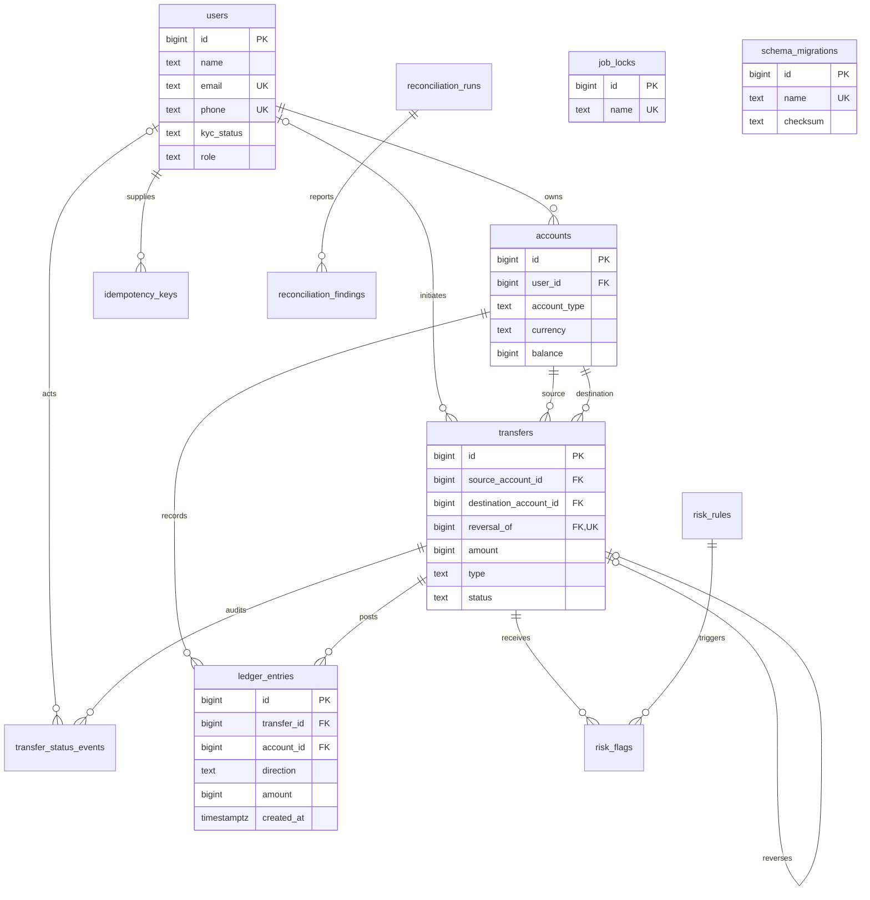

# Schema design

## Noun inventory

| Requirement noun | Storage decision |
|---|---|
| User | `users`: name, email, phone, KYC status, application role |
| Wallet / system account | `accounts`: owner, type, currency, cached balance |
| Transfer | `transfers`: business event, endpoints, amount, type, status, reversal link |
| Debit / credit / ledger line | `ledger_entries`: positive amount and explicit direction |
| Idempotency key | `idempotency_keys`: caller-scoped UUID, request hash, saved response |
| Status change | `transfer_status_events`: actor, old/new status, timestamp |
| Fraud rule | `risk_rules`: configurable threshold, time window, hold/flag action |
| Fraud flag / model explanation | `risk_flags`: transfer, rule snapshot, explanation, label |
| Reconciliation run | `reconciliation_runs`: timestamps, status, counts, error |
| Reconciliation problem | `reconciliation_findings`: check, entity, expected/actual values |
| Scheduled job lock | `job_locks`: one stable row per job |
| Migration | `schema_migrations`: applied SQL file and checksum; runner-managed |
| Currency | Constrained `INR` column; no separate table for one supported value |
| Transfer type / KYC status / direction | Constrained columns, not lookup tables |
| Statement / balance | Query results and cached account attribute, not separate entities |
| Fee / top-up / withdrawal | Transfer types; system endpoints use the same account model |
| Reversal | New transfer linked to the original, not a ledger edit |
| Authentication token | Deferred to the authentication milestone |

Every table uses a system-generated `BIGINT` identity primary key. Emails and phone
numbers are externally supplied, changeable identifiers, so they are unique
attributes rather than primary keys. Email uniqueness is case-insensitive; phone
normalization will happen at the API boundary.

## Cardinalities

- One user owns zero or many wallets; each wallet has exactly one user. System
  accounts have no owner. `accounts.user_id` sits on the many side.
- One account participates in many transfers as source or destination and has
  many ledger entries. Each transfer has one source and one destination account.
- One posted transfer has at least two ledger entries; pending, held, and rejected
  transfers have none at commit. Every entry references exactly one transfer and
  one account. Entries carry the attributes of the account/transfer relationship.
- One user has many idempotency keys; `(user_id, key)` is unique.
- One transfer has many status events; user actors are optional for system events.
- Transfers and risk rules are many-to-many through `risk_flags`, which also
  preserves the rule configuration that caused the flag.
- One reconciliation run has many findings. Finding entity IDs deliberately have
  no foreign key: a report must be able to describe missing or corrupted records.
- A transfer has zero or one full reversal, enforced by a unique self-reference.

## Entity relationship diagram

## Accounting conventions

Amounts are whole paise stored in `BIGINT`. Direction is explicit: a debit reduces
an account balance and a credit increases it. This is a uniform signed-movement
convention for the wallet subledger, including system clearing accounts, rather
than a full general ledger with account-specific normal balances.

For example, a simulated 25,000-paise top-up debits cash-in and credits a user's
wallet. Cash-in becomes -25,000 and the wallet becomes +25,000. System accounts
may be negative; user wallets may not. An outgoing fee is its own transfer into
fee revenue, keeping each transfer's amount and endpoints unambiguous.

Both cached and computed balances are useful. A stored balance makes reads and
locked funds checks constant-time, at the cost of an extra write and a consistency
obligation. Computing every balance from entries removes that cache but becomes
more expensive as history grows. The application will update cached balances in
the posting transaction; nightly reconciliation will independently compare them.
The first milestone does not implement the posting service or reconciliation job.

Keeping wallets and system accounts together lets ledger foreign keys reference
one account type and gives all money movements the same posting structure.

## Query-driven indexes

| Query | Index | Cost / reason |
|---|---|---|
| User wallets | `accounts_user_id` | Small owner lookup; excludes system rows |
| One system account of each type | `accounts_system_type` | Partial unique index |
| Statement, newest first | `ledger_entries_statement` | Account then descending timestamp/ID |
| Transfer's ledger lines | `ledger_entries_transfer` | Posting checks and transfer details |
| Outgoing history / fraud windows | `transfers_source_time` | Source and time-range lookup |
| Incoming history | `transfers_destination_time` | Destination and time-range lookup |
| Review queue | `transfers_held` | Indexes only held records |
| Transfer audit trail | `transfer_status_events_transfer` | Stable timestamp/ID ordering |
| Unexplained risk flags | `risk_flags_unexplained` | Pending explanation work only |
| Findings for a report | `reconciliation_findings_run` | Report detail lookup |

Primary keys and unique constraints also create indexes. Every additional index
adds storage and write maintenance. Do not index every status or timestamp by
default; later benchmarks will justify additions. Global reconciliation aggregates
may reasonably use sequential scans.

## Migrations and runtime access

SQL migrations are applied in filename order in one transaction. A transaction
advisory lock serializes runners. Applied checksums prevent silently changing an
existing migration; a failure rolls back the entire pending batch.

Compose runs migrations as the database owner, then provisions a separate
`wallet_app` login for the API and worker. Credentials are supplied through libpq
environment variables. Runtime access cannot create schema objects or modify the
migration history. Owner credentials are reserved for migrations and tests.

Owner/superuser access is trusted administrative access; it can disable triggers.
Corruption fixtures must use an isolated test schema, never a production database.
