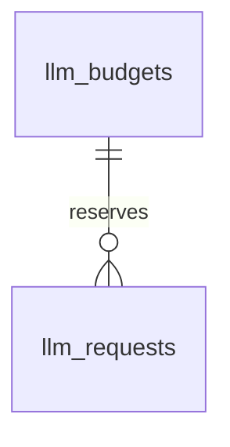
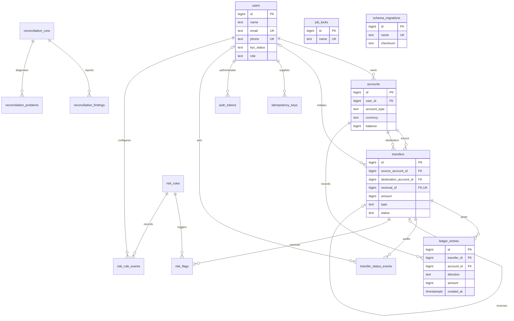

# Schema design

Hosted model admission adds two operational entities in migration 0008:
`llm_budgets` (unique endpoint/model scope hash and cooldown) and `llm_requests`
(reservation time and token allowance). Both use generated BIGINT primary keys.
One budget has many request reservations through `budget_id`; neither contains
prompts, customer rows or credentials. The `(budget_id, created_at)` index supports
rolling-window counts and pruning at the cost of one index write per model call.
The runtime role may delete expired reservations but cannot delete money records.
These controls do not participate in double-entry accounting.

## Noun inventory

| Requirement noun | Storage decision |
|---|---|
| User | `users`: name, email, phone, KYC status, application role |
| Wallet / system account | `accounts`: owner, type, currency, cached balance |
| Transfer | `transfers`: business event, endpoints, amount, type, status, reversal link |
| Debit / credit / ledger line | `ledger_entries`: positive amount and explicit direction |
| Idempotency key | `idempotency_keys`: caller-scoped UUID, request hash, saved response |
| Status change | `transfer_status_events`: actor, old/new status, timestamp |
| Fraud rule | `risk_rules`: configurable threshold, time window, hold/flag action |
| Fraud flag / model explanation | `risk_flags`: transfer, rule snapshot, explanation, label |
| Rule configuration change | `risk_rule_events`: rule, admin actor, old/new configuration |
| Reconciliation run | `reconciliation_runs`: timestamps, status, counts, error |
| Invariant violation | `reconciliation_findings`: raw check, entity, expected/actual values |
| Event comparison | `reconciliation_problems`: entry/cache discrepancies against posted transfers |
| Scheduled job lock | `job_locks`: one stable row per job |
| Migration | `schema_migrations`: applied SQL file and checksum; runner-managed |
| Currency | Constrained `INR` column; no separate table for one supported value |
| Transfer type / KYC status / direction | Constrained columns, not lookup tables |
| Statement / balance | Query results and cached account attribute, not separate entities |
| Fee / top-up / withdrawal | Transfer types; system endpoints use the same account model |
| Reversal | New transfer linked to the original, not a ledger edit |
| Authentication token | `auth_tokens`: user, unique SHA-256 hash, creation/revocation times |

Every table uses a system-generated `BIGINT` identity primary key. Emails and phone
numbers are externally supplied, changeable identifiers, so they are unique
attributes rather than primary keys. Email uniqueness is case-insensitive; phone
normalization will happen at the API boundary.

## Cardinalities

- One user owns zero or many wallets; each wallet has exactly one user. System
  accounts have no owner. `accounts.user_id` sits on the many side.
- One account participates in many transfers as source or destination and has
  many ledger entries. Each transfer has one source and one destination account.
- One posted transfer has at least two ledger entries; pending, held, and rejected
  transfers have none at commit. Every entry references exactly one transfer and
  one account. Entries carry the attributes of the account/transfer relationship.
- One user has many idempotency keys; `(user_id, key)` is unique.
  A deferred constraint requires a completed response at commit; completed
  responses and key identity fields cannot be updated. See [replay](idempotency.md).
- One user has many authentication tokens; each token belongs to exactly one user.
- One transfer has many status events; user actors are optional for system events.
- Transfers and risk rules are many-to-many through `risk_flags`, which also
  preserves the rule configuration that caused the flag.
- Rules have many immutable configuration events; each event has one admin actor.
- One reconciliation run has many findings and event-comparison problems. Their entity IDs have
  no foreign key: a report must be able to describe missing or corrupted records.
- A transfer has zero or one full reversal, enforced by a unique self-reference.

## Entity relationship diagram

## Accounting conventions

Amounts are whole paise stored in `BIGINT`. Direction is explicit: a debit reduces
an account balance and a credit increases it. This is a uniform signed-movement
convention for the wallet subledger, including system clearing accounts, rather
than a full general ledger with account-specific normal balances.

For example, a simulated 25,000-paise top-up debits cash-in and credits a user's
wallet. Cash-in becomes -25,000 and the wallet becomes +25,000. System accounts
may be negative; user wallets may not. An outgoing fee is its own transfer into
fee revenue, keeping each transfer's amount and endpoints unambiguous.

Both cached and computed balances are useful. A stored balance makes reads and
locked funds checks constant-time, at the cost of an extra write and a consistency
obligation. Computing every balance from entries removes that cache but becomes
more expensive as history grows. The application will update cached balances in
the posting transaction; nightly reconciliation will independently compare them.
The posting service now updates the cache atomically with entries. Scheduled
reconciliation follows in milestone 4.

Keeping wallets and system accounts together lets ledger foreign keys reference
one account type and gives all money movements the same posting structure.

## Database protections

| Invariant | Enforcement |
|---|---|
| Positive money amounts | `BIGINT` columns with `CHECK (amount > 0)` |
| User wallets cannot have negative stored balances | Conditional account balance check |
| Accounts start empty | Insert trigger rejects nonzero opening balances |
| Wallets have owners; system accounts do not | Ownership check and immutable account identity |
| Posted transfers balance and match their amount | Deferred constraint triggers on transfers and entries |
| Entries belong to the declared transfer endpoints | Deferred posting validator checks debit/credit accounts |
| Unposted transfers move no money | Deferred validator requires zero entries |
| Ledger and status history are append-only | Mutation/truncation triggers plus runtime permissions |
| Posted transfers cannot acquire extra entries | Insert guard locks the parent and rejects completed states |
| Status transitions are valid and audited | Transfer guards and automatic status-event trigger |
| One exact full reversal of an original transfer | Unique reversal link plus endpoint/amount/status validation |
| Idempotency keys are caller-scoped | Unique `(user_id, key)` constraint |

The posting checks are deferred until commit so a transaction can create a pending
transfer, append all lines, and mark it posted atomically. A posted transfer's
debit total and credit total must each equal its declared amount. Multiple lines
per direction are permitted, but all debits belong to the source and all credits
to the destination. Fees are separate transfers rather than split postings.

Allowed state changes are `pending -> held/posted/rejected` and
`held -> posted/rejected`. Posted and rejected states are terminal. Reversal keeps
the original posted and adds a separate inverse transfer; reversal-of-reversal
and partial reversals are not supported. A reserved reversal link is unique even
before posting, preventing simultaneous reversal attempts.

Status events use the transaction-local `wallet.actor_id` setting when supplied.
Initial events fall back to `initiated_by`; otherwise the actor is recorded as
system. The authenticated posting service sets that actor before changing a
transfer. Runtime SQL is trusted service code, not a user-query interface.

The database does not automatically update cached balances from ledger inserts.
The posting service must perform those updates within the same transaction.
Reconciliation will detect any cache/ledger mismatch independently.

## Query-driven indexes

| Query | Index | Cost / reason |
|---|---|---|
| User wallets | `accounts_user_id` | Small owner lookup; excludes system rows |
| One system account of each type | `accounts_system_type` | Partial unique index |
| Statement, newest first | `ledger_entries_statement` | Account then descending timestamp/ID |
| Transfer's ledger lines | `ledger_entries_transfer` | Posting checks and transfer details |
| Outgoing history / fraud windows | `transfers_source_time` | Source and time-range lookup |
| Incoming history | `transfers_destination_time` | Destination and time-range lookup |
| Review queue | `transfers_held` | Indexes only held records |
| Transfer audit trail | `transfer_status_events_transfer` | Stable timestamp/ID ordering |
| Unexplained risk flags | `risk_flags_unexplained` | Pending explanation work only |
| Findings for a report | `reconciliation_findings_run` | Report detail lookup |

Primary keys and unique constraints also create indexes. Every additional index
adds storage and write maintenance. Do not index every status or timestamp by
default; later benchmarks will justify additions. Global reconciliation aggregates
may reasonably use sequential scans.

## Migrations and runtime access

SQL migrations are applied in filename order in one transaction. A transaction
advisory lock serializes runners. Applied checksums prevent silently changing an
existing migration; a failure rolls back the entire pending batch.

Compose runs migrations as the database owner, then provisions a separate
`wallet_app` login for the API and worker. Credentials are supplied through libpq
environment variables. Runtime access cannot create schema objects or modify the
migration history. Owner credentials are reserved for migrations and tests.

Owner/superuser access is trusted administrative access; it can disable triggers.
Corruption fixtures must use an isolated test schema, never a production database.

Implementation references: PostgreSQL's [deferred constraint triggers](https://www.postgresql.org/docs/16/sql-createtrigger.html),
psycopg's [transaction contexts](https://www.psycopg.org/psycopg3/docs/basic/transactions.html),
and Docker Compose's [startup dependencies](https://docs.docker.com/compose/how-tos/startup-order/).
